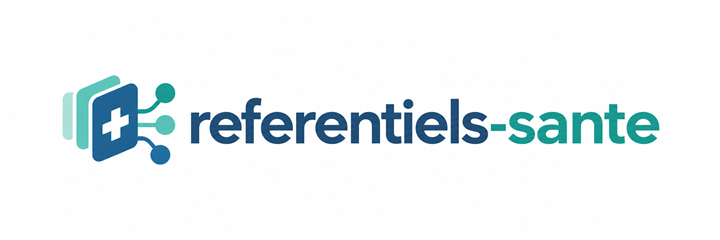

# referentiels-sante

<p align="center"></p>

<p align="center">
<a href="https://referentiels-sante.irreductix.fr/controle/"></a>
<a href="https://referentiels-sante.irreductix.fr/"></a>
<a href="https://www.data.gouv.fr/datasets/finess-en-csv-conversion-mensuelle-de-finess"></a>
<a href="https://www.data.gouv.fr/datasets/base-de-donnees-publique-des-medicaments-en-csv-conversion-mensuelle"></a>
<a href="https://www.npmjs.com/package/referentiels-sante"></a>
<a href="https://irreductix.fr/"></a>
</p>

**Les référentiels publics de la santé en France, convertis en CSV propres, et
en JSON pour FINESS+, NOS, CIM-10 et GHS. Sans dépendance, en une commande.**

Site : <https://referentiels-sante.irreductix.fr/>, avec la page [Contrôle FINESS](https://referentiels-sante.irreductix.fr/controle/) pour vérifier une liste d'établissements dans le navigateur  
Fichiers du mois sur data.gouv.fr : [FINESS en CSV](https://www.data.gouv.fr/datasets/finess-en-csv-conversion-mensuelle-de-finess) et [Base des médicaments en CSV](https://www.data.gouv.fr/datasets/base-de-donnees-publique-des-medicaments-en-csv-conversion-mensuelle)  
Un outil libre du collectif [Irréductix](https://irreductix.fr)

Les données de référence du système de santé sont publiques, mais publiées dans
des formats pénibles : JSON de 750 Mo impossible à charger en mémoire, CSV en
ISO-8859-1 à virgule décimale et dates à la française, tables de codes en XML
SVS, PDF. Chaque équipe qui en a besoin refait la même conversion dans son coin.

Ce projet fait cette conversion une fois pour toutes, la documente, la teste,
et produit des fichiers directement exploitables dans Excel, une base SQL, un
entrepôt de données ou un script.

| Référentiel | Source | Ce que l'on produit |
|---|---|---|
| **FINESS+** structures | ANS, data.gouv.fr (flux quotidien, Licence Ouverte 2.0) | entités juridiques, établissements, groupements (GHT, GCS) avec libellés, coordonnées, agrégats |
| **FINESS+** activités | ANS, data.gouv.fr | activités autorisées et exercées, statut, capacités autorisées et installées |
| **NOS** | ANS, nomenclatures des objets de santé | toute table de référence (catégorie d'établissement, statut juridique, département…) en CSV et JSON |
| **CCAM** | Assurance Maladie, base dBase en page de code DOS | actes avec libellés recollés et chapitres numérotés, activités, phases, prix par grille tarifaire, modificateurs, notes |
| **CIM-10 FR à usage PMSI** | ATIH, fichiers ClaML annuels | codes avec hiérarchie (chapitre, bloc, catégorie), inclusions, exclusions, notes, variantes françaises |
| **Médicaments** | Base de données publique des médicaments (Licence Ouverte) | spécialités, présentations CIP, compositions, avis SMR et ASMR, génériques, conditions de prescription, disponibilité |
| **NABM, LPP, UCD** | Assurance Maladie, tables dBase | biologie, dispositifs et prestations, unités communes de dispensation, en CSV UTF-8 |
| **Tarifs GHS, GHT, suppléments** | ATIH, arrêtés tarifaires MCO et HAD | tarifs des deux secteurs, nombres et dates normalisés |
| **N'importe quel DBF** | | conversion d'une table dBase locale ou d'une archive en CSV |

Le flux FINESS+ a remplacé l'ancienne extraction FINESS le 20 juillet 2026.
Pour ne pas casser les chaînes de traitement existantes, l'outil produit
aussi un fichier au **format de l'ancien flux** (32 colonnes `structureet`),
comparé champ par champ à la dernière extraction Etalab : les écarts restants
sont documentés et viennent de la source ([docs/FINESS.md](docs/FINESS.md)).

## Sans rien installer

**Les fichiers déjà convertis.** FINESS+ et la base publique des médicaments
sont sous Licence Ouverte : ils sont convertis et publiés le 2 de chaque mois
dans les [releases](https://github.com/irreductix/referentiels-sante/releases)
(`finess-AAAAMM`, `bdpm-AAAAMM`), avec un fichier `MENTION-SOURCE.txt` qui
donne le producteur, la licence et la date des données. `AAAAMM` est le mois de
publication : l'archive FINESS contient le dernier instantané mensuel paru à
cette date, celui du mois précédent, dont le nom figure dans
`MENTION-SOURCE.txt`. La dernière archive de chacun reste toujours à la même
adresse :

- FINESS+ : <https://github.com/Irreductix/referentiels-sante/releases/download/donnees-du-mois/finess.zip>
- médicaments : <https://github.com/Irreductix/referentiels-sante/releases/download/donnees-du-mois/bdpm.zip>

Les autres référentiels ne sont jamais publiés tout convertis : leur licence ne
le permet pas ([docs/SOURCES.md](docs/SOURCES.md)).

**La version Windows.** Chaque version publie une archive
`referentiels-sante-x.y.z-windows.zip` qui contient l'outil et le Node.js
officiel : on la décompresse, on double-clique sur `Convertir.cmd` et on choisit
FINESS+, la CCAM, la CIM-10, les médicaments, la NABM, la LPP, les UCD ou les
tarifs GHS. Les tables NOS et les fichiers DBF se convertissent avec
`referentiels-sante.cmd`, qui accepte les mêmes arguments que la commande npx.
Ni installation, ni droit d'administrateur. Les données
sont téléchargées à la source au moment de la conversion, sur le poste de
l'agent.

## Démarrage

Prérequis : [Node.js](https://nodejs.org) 22 ou plus récent. Rien d'autre.

```bash
npx referentiels-sante finess
```

Cette commande télécharge le flux FINESS+ du jour (50 Mo), les tables de codes
de l'ANS, et écrit dans `data/finess/` :

| Fichier | Contenu |
|---|---|
| `etablissements.csv` / `.jsonl` | un établissement (FINESS ET) par ligne : identifiants, catégorie et ses agrégats, statut ESPIC, mode de fixation tarifaire, dates, adresse normalisée, coordonnées, contacts, rattachement à l'entité juridique |
| `entites-juridiques.csv` / `.jsonl` | une entité juridique (FINESS EJ) par ligne : SIREN, statut juridique et agrégats, code APE, adresse du siège, nombre d'établissements |
| `groupements-conventionnels.csv` | groupements sans personnalité morale, dont les 135 GHT, avec leur établissement support |
| `groupements-cooperation.csv` | groupements dotés de la personnalité morale (GCS…) |
| `groupements-membres.csv` | les membres de tous les groupements, résolus en numéros FINESS |
| `etablissements-format-historique.csv` | l'ancien format Etalab, pour les traitements qui lisaient l'extraction FINESS d'avant juillet 2026 |
| `structures-resume.json` | date du flux, version du schéma, comptages, tables de libellés utilisées |

Avec `--activites`, l'outil traite aussi le flux activités (autorisations,
équipements matériels lourds, capacités) et écrit `activites.csv` / `.jsonl`.

```bash
npx referentiels-sante finess --activites
npx referentiels-sante nos TRE_R66-CategorieEtablissement TRE_R72-FinessStatutJuridique
npx referentiels-sante ccam                    # data/ccam : actes, activités, phases, tarifs, chapitres, notes
npx referentiels-sante cim10 --edition 2025    # data/cim10 : 11 969 codes avec hiérarchie et rubriques
npx referentiels-sante bdpm                    # data/bdpm : dix fichiers de la base des médicaments
npx referentiels-sante nabm                    # idem lpp, ucd
npx referentiels-sante ghs --annee 2026
npx referentiels-sante dbf fichier.dbf
npx referentiels-sante verifier                # les sources répondent-elles encore ?
npx referentiels-sante --aide
```

Les sources sont des pages web, pas des API : elles changent sans prévenir.
`verifier` contrôle chaque semaine en intégration continue que les pages ont
encore la forme attendue, que chaque fichier répond, et que les adresses de
repli embarquées sont à jour ; un échec ouvre un ticket. La CCAM fait exception :
le site de l'Assurance Maladie refuse les serveurs d'intégration continue, un
simple avertissement le signale, et elle se vérifie depuis un poste (voir
[docs/AUTRES-REFERENTIELS.md](docs/AUTRES-REFERENTIELS.md)). Quand une source
publie une nouvelle version, la même tâche ouvre une pull request qui met à jour
les replis (`npx referentiels-sante replis`), ou un ticket avec le lien pour
l'ouvrir si l'organisation interdit aux workflows d'en créer.

Détail des colonnes : [docs/FINESS.md](docs/FINESS.md), [docs/CCAM.md](docs/CCAM.md),
[docs/AUTRES-REFERENTIELS.md](docs/AUTRES-REFERENTIELS.md) (CIM-10, médicaments, NABM, LPP, UCD).

Les téléchargements sont mis en cache dans `.cache/` ; `--forcer` les renouvelle.
`--sans-libelles` évite tout appel aux tables NOS (codes seuls, hors ligne).

## Utilisation comme bibliothèque

```js
import { finess, nos, ghs, lireCollection } from 'referentiels-sante';

// Convertir un flux déjà téléchargé, avec les libellés officiels.
const libelles = await finess.chargerLibelles({ cache: '.cache' });
const resume = await finess.convertirStructures({
  entree: '.cache/finess/finess-structures-journalier-20260911.json.gz',
  sortie: 'data/finess',
  libelles,
});

// Ou parcourir le JSON de 750 Mo objet par objet, sans le charger en mémoire.
for await (const pmej of lireCollection('finess-structures.json.gz', 'pmej')) {
  console.log(pmej.informationsGeneralesPMEJ.numFinessPm, pmej.ege.length);
}

// Une table de codes de l'ANS.
const categories = await nos.chargerTable('TRE_R66-CategorieEtablissement');
console.log(nos.indexLibelles(categories).get('355')); // Centre hospitalier (CH)

// Les tarifs d'une archive ATIH.
const tarifs = ghs.convertirArchive('ghs_web_20260101.zip');
```

Mesures sur un poste de travail, flux du 14 septembre 2026 pour les structures, du 11 septembre pour les activités, CCAM V84 et CIM-10 FR 2025. La mémoire indiquée est le pic de mémoire du processus :

| Traitement | Contenu | Durée | Mémoire au pic |
|---|---|---|---|
| lecture seule du flux structures (50 Mo compressés, 751 Mo décompressés) | 98 221 entités juridiques, 174 714 établissements | 8 s | 104 Mo |
| conversion complète des structures, libellés et format historique compris | idem, plus 135 GHT et 1 858 groupements de coopération | 16 s | 231 Mo |
| conversion complète des activités (58 Mo compressés) | 294 753 activités autorisées, 294 774 activités exercées | 21 s | 209 Mo |
| CCAM V84 (27 Mo compressés, 72 tables dBase) | 8 558 actes, 13 741 activités, 967 106 prix par grille, 44 925 notes | 14 s | 429 Mo |
| CIM-10 FR 2025 (ClaML) | 11 969 codes | moins d'une seconde | 233 Mo |

## Ce que l'outil ne fait pas

- Il ne redistribue **pas** les données : il les télécharge à la source
  officielle au moment de l'exécution. Seuls FINESS+ et la base des
  médicaments, sous Licence Ouverte, sont republiés déjà convertis dans les
  releases (voir « Sans rien installer »). Ce que vous produisez reste soumis à
  la licence de la source (voir [docs/SOURCES.md](docs/SOURCES.md)).
- Il ne réinterprète pas les données : chaque colonne est tracée jusqu'au champ
  d'origine dans [docs/FINESS.md](docs/FINESS.md). Les seules règles de calcul
  (statut et capacités des activités) sont celles publiées par l'ANS.
- Il ne couvre pas la NGAP, que l'Assurance Maladie ne publie qu'en PDF, ni
  le RPPS. Voir [docs/SOURCES.md](docs/SOURCES.md) et
  [CONTRIBUTING.md](CONTRIBUTING.md).

## Architecture

```
src/
  cli.js                ligne de commande
  commun/json-flux.js   lecteur JSON en flux (tableaux de premier niveau)
  commun/csv.js         écriture CSV et JSON Lines en flux, lecture CSV
  commun/telecharger.js téléchargement avec cache
  commun/zip.js         lecteur et extracteur ZIP en flux
  commun/dbf.js         lecteur dBase en flux, page de code DOS
  commun/xml.js         analyseur XML minimal (ClaML, SVS)
  commun/dates.js       normalisation des dates et nombres
  finess/sources.js     localisation des flux sur data.gouv.fr
  finess/libelles.js    jointure avec les tables NOS
  finess/aplatir.js     PMEJ, EGE, groupements vers lignes tabulaires
  finess/activites.js   activités, statut et capacités (règles ANS)
  finess/convertir.js   orchestration en flux
  nos/index.js          tables NOS (.tabs) vers concepts normalisés
  ccam/index.js         base dBase CCAM vers synthèse et tables
  cim10/index.js        ClaML vers codes hiérarchisés
  bdpm/index.js         fichiers tabulés de la base des médicaments
  cnam/index.js         NABM, LPP, UCD depuis les pages de codage de l'Assurance Maladie
  ghs/index.js          archives tarifaires ATIH
tests/                  node:test, fixtures publiées par l'ANS
```

Aucune dépendance npm : Node.js seul (`node:zlib`, `node:stream`, `fetch`).

## Licence

Code sous licence [MIT](LICENSE). Les données produites restent la propriété
de leurs producteurs et sont soumises à leurs licences respectives, détaillées
dans [docs/SOURCES.md](docs/SOURCES.md). La mention de la source et de la date
d'extraction est incluse dans chaque fichier `*-resume.json`.
